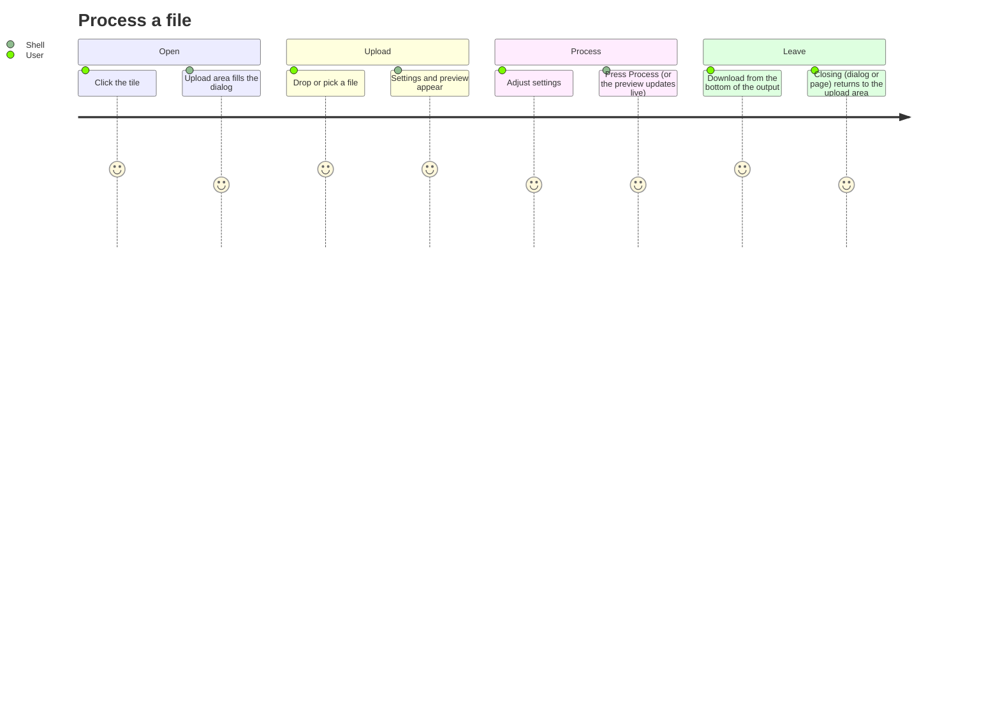

# File Processor

Upload a file, process it, download the result. Built from
`FileProcessorShell` (`src/components/common/file-processor/`), which
merged `ImageToolShell` and `ImageBatchShell` (ADR-0028). `multiple`
picks batch mode; otherwise `output` says what one file turns into:

- **Single (`file`, the default):** one file, a live preview that follows
  the controls, one result.
- **Assets (`assets`):** one image in, many files out (favicons, splash
  screens). A card per file downloads it, Download ZIP sits at the bottom,
  and copyable text (link tags, a manifest) can sit beside the cards.
- **Text (`text`):** one image in, labelled text blocks out, each with Copy
  in its label. No download.
- **Batch (`multiple`):** a queue of files, a live preview of one of them, a
  Process button, then one result per file plus a ZIP.

There's **one way in**: the tile is a plain button, and the upload area
fills the dialog's work area until a file is added. Only the UX is
unified. Each Tool keeps its own file checking (`validate`, defaulting to
`accept`) and preview code (ADR-0016).

```
Before upload:
┌ Image Resizer ───────────────────────────────────────────────── [×] ┐
│ Status                                                                │
├──────────────────────────────────────────────────────────────────────┤
│               ┌ ─ ─ ─ ─ ─ ─ ─ ─ ─ ─ ─ ─ ─ ─ ─ ─ ─ ┐                    │
│                 Drop images here, or [ Select… ]                      │
│               └ ─ ─ ─ ─ ─ ─ ─ ─ ─ ─ ─ ─ ─ ─ ─ ─ ─ ┘                    │
└──────────────────────────────────────────────────────────────────────┘

After upload (batch):
┌ Image Resizer ───────────────────────────────────────────────── [×] ┐
│ Controls  Width [ 800 ]  Height [    ]  Mode ▾  Format ▾              │
│ Status    ⚠ Preview failed: …   /   1 image could not be processed…   │
├───────────────────────────────┬──────────────────────────────────────┤
│ 3 images                      │ Original ┊ Resized                   │
│ ▢ wide.png        ×           │                                      │
│ ▢ tall.png        ×           │                                      │
│ [ Add more images ]           │                                      │
│ [ Resize 3 images ]           │ [ Download ] / [ Download ZIP ]      │
└───────────────────────────────┴──────────────────────────────────────┘

After upload (single):
┌ Image Cropper ───────────────────────────────────────────────── [×] ┐
│ Controls  Free  1:1  16:9 …                                           │
│ Status    ⚠ Could not process this file                              │
├───────────────────────────────┬──────────────────────────────────────┤
│ Source (e.g. crop box)        │ Result preview                       │
│ [ Choose another image ]      │ [ Download ]                         │
└───────────────────────────────┴──────────────────────────────────────┘

After upload (assets, with a Process button):
┌ Splash Screen Generator ─────────────────────────────────────── [×] ┐
│ Controls  Background ■ #ffffff   Image scale ━━━●━━ 50%               │
│ Status                                                                │
├───────────────────────────────┬──────────────────────────────────────┤
│ Live preview of the controls  │ ( iPhone splash )( iPad )( Icons )    │
│                               │ ▢ 16x16  ▢ 32x32  ▢ …   ← click = get │
│                               │ iOS meta tags                  [⧉]    │
│ [ Generate All Assets ]       │ Manifest icons JSON            [⧉]    │
│ [ Choose another image ]      │ [ Download ZIP ]                     │
└───────────────────────────────┴──────────────────────────────────────┘

After upload (text):
┌ Image to Base64 ─────────────────────────────────────────────── [×] ┐
├───────────────────────────────┬──────────────────────────────────────┤
│ Source image                  │ Data URI                       [⧉]    │
│ logo.png — 64x64 — 2 KB       │ Base64 · 2.7 KB                [⧉]    │
│ [ Choose another image ]      │ HTML tag                       [⧉]    │
└───────────────────────────────┴──────────────────────────────────────┘
```

## Rules

- **Validation:** picks and drops both go through the Tool's `validate`
  (a drop skips the picker's `accept`). A rejected file is a toast,
  because reading a file is an action. Valid files in the same pick are
  still taken.
- **Run timing:**
  - Single and text/assets: runs when a file is added and on every control
    change (Compressor debounces its quality slider).
  - Assets that are slow on purpose (Splash) get a Process button under the
    input instead; a control change waits for the next press, and the
    button shows progress ("Generating 12/40") while it runs.
- **Errors:**
  - Single, assets, text: a processing error shows in the status slot. The
    result is cleared and there is no Download.
  - Assets and text decode the image when it is added; an image the
    browser can't read is a toast (`rejectToastLabel`), like a rejected
    file.
  - Batch: a preview error shows in the status slot. In a run, a failed
    file keeps its row with the reason, and a notice counts the failures.
    Only when every file fails is there a toast; the queue stays for
    another try.
- **Buttons:** Process and "Choose another image" / "Add more images" sit
  under the input. ⌘/Ctrl+Enter presses Process while it is enabled (not
  while it runs), with the key hint beside it, as for Generate. Download and Download ZIP sit at the bottom of the
  output. Each asset card downloads its own file; each text block has Copy
  in its label.
- **Reset:** closing the dialog drops the files and returns to the upload
  area. There is no Reset or "Start over" button. Removing the last
  queued file also returns there. "Choose another image" keeps the
  controls; closing restores their initial values.

## Journey



## Tools

- **On the shell:**
  - Single (`file`): Background Remover, Compressor, Cropper.
  - Assets: Favicon, Splash Screen.
  - Text: Image → Base64.
  - Batch: Converter, Resizer.
- **Not File Processors:** Color Picker and Data URI are `custom`.
